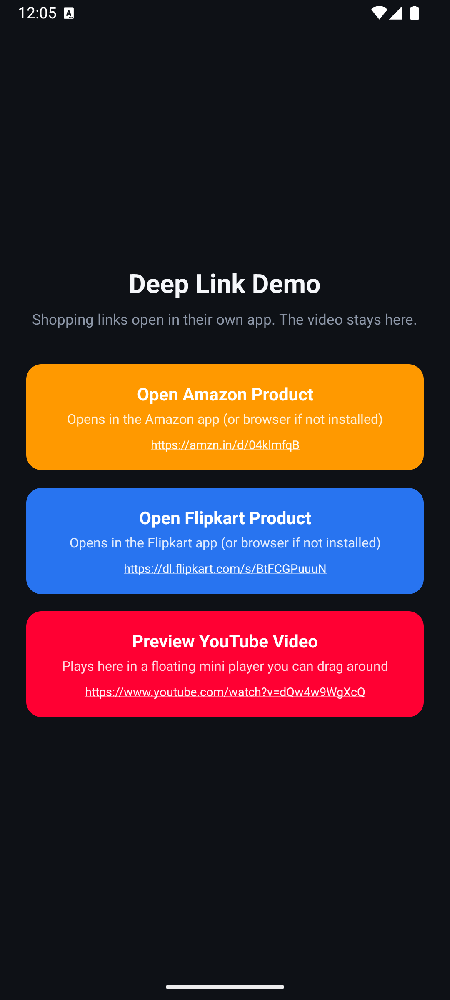
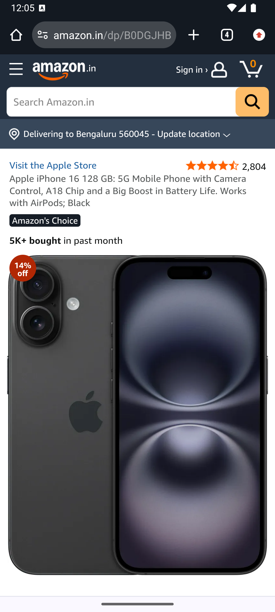
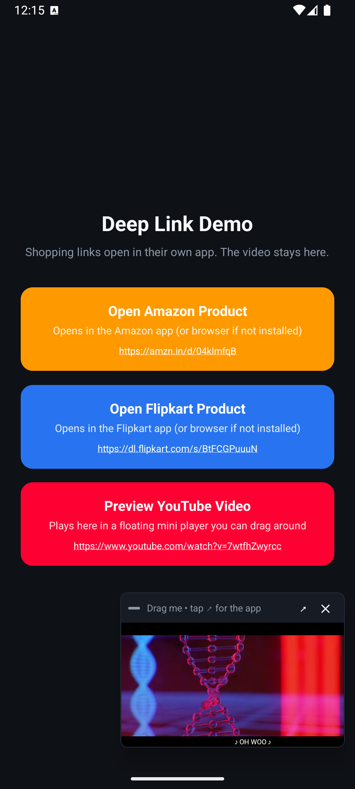
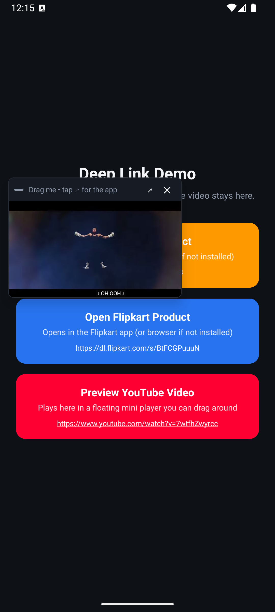

# DeepLink

A small React Native app with **three buttons**. Two of them send you out to another app, and one keeps you inside and plays a video in a little floating window.

| Button | What happens when you tap it |
| --- | --- |
| **Open Amazon Product** | Leaves the app and opens the product in the Amazon app. No Amazon app? It opens in the browser instead. |
| **Open Flipkart Product** | Same idea — opens in the Flipkart app, or the browser if Flipkart is not installed. |
| **Preview YouTube Video** | Stays in the app. A small video window pops up that you can **drag anywhere**, just like the mini video player in WhatsApp. |

---

## What it looks like

### 1. The main screen

Three buttons in the middle of the screen. Each one shows its name, a short hint, and the real link it will open — so you always know where you are about to go.



### 2. After tapping "Open Amazon Product"

The app hands the link to the phone, and the phone opens the product page.



Notice the address bar: we tapped the short link `https://amzn.in/d/04klmfqB`, and it landed on the real product page `amazon.in/dp/B0DGJHB...`. The short link redirected us automatically.

> **Why does this screenshot show a browser and not the Amazon app?**
> These screenshots were taken on an Android emulator, which does not have the Amazon or Flipkart apps installed. On a real phone that **has** those apps, the same tap opens the app directly instead of the browser. Both results are correct — the phone picks whichever is available.

### 3. After tapping "Preview YouTube Video"

This one is different — **you never leave the app**. A small video window appears at the bottom and starts playing straight away. The three buttons stay right where they are, and you can still use them.



### 4. Drag the video anywhere

Put your finger on the little window and move it. The video keeps playing while you drag, and it will not slide off the edge of the screen — exactly like the mini player in WhatsApp.



The small bar on top of the video has two buttons:

- **↗** — jump out to the real YouTube app
- **✕** — close the mini player

---

## How to run it

You need [the React Native environment](https://reactnative.dev/docs/set-up-your-environment) set up first.

```sh
# 1. install packages
npm install

# 2. iOS only - install native iOS dependencies
cd ios && pod install && cd ..

# 3. start the JavaScript server
npm start

# 4. in a second terminal, build and install the app
npm run android
# or
npm run ios
```

> **Important:** if you change anything in `AndroidManifest.xml` or `Info.plist`, you must run `npm run android` / `npm run ios` again. Those are native files — just reloading from Metro will **not** pick them up. (This exact thing caused a bug once; see [Notes](#notes-things-that-tripped-us-up) at the bottom.)

---

## Folder structure

```
App.tsx                                   app entry, adds safe-area padding
jest.setup.js                             test helper (fakes the video view)

src/
├── config/
│   └── links.config.ts                   the 3 links live here
├── types/
│   └── link.types.ts                     shared TypeScript types
├── theme/
│   └── colors.ts                         colours, spacing, corner radius
├── services/
│   └── deepLink.service.ts               sends a link to the phone
├── utils/
│   └── youtube.utils.ts                  reads the video id out of a YouTube link
├── components/
│   ├── LinkButton/                       one coloured button
│   └── FloatingVideoPlayer/              the draggable mini video window
└── screens/
    └── HomeScreen/                       the main screen

docs/screenshots/                         the images used in this README
```

### Want to change a link or add a fourth button?

Everything is in **one file**: `src/config/links.config.ts`. Edit the `url`, or copy one block and change it. The screen builds itself from this list, so you do not need to touch any UI code.

```ts
{
  id: 'amazon-product',
  label: 'Open Amazon Product',
  description: 'Opens in the Amazon app (or browser if not installed)',
  url: 'https://amzn.in/d/04klmfqB',
  openMode: 'external',        // 'external' = leave the app
  accentColor: colors.amazon,  // 'inAppPreview' = floating video player
}
```

---

## How the two behaviours work

### Leaving the app (Amazon / Flipkart)

We simply hand the link to the phone:

```ts
await Linking.openURL(url);
```

The phone then checks which installed app has claimed that website address. Amazon installed? The Amazon app opens. Not installed? The browser opens. We never draw those pages ourselves — the real app or the real website does.

### Staying in the app (YouTube)

Tapping the YouTube button does **not** leave the app. Instead it shows a small window on top of the screen that plays the video.

- **Drag it** anywhere with your finger. It will not slide off the screen edges.
- **Tap ↗** to jump to the full YouTube app.
- **Tap ✕** to close it.
- The buttons behind it still work while the video plays.

Inside, the window is a `WebView` (a tiny built-in browser) showing YouTube's embedded player. Getting that player to actually start took two tries — see [the YouTube notes](#the-video-would-not-play--error-153-then-error-152) at the bottom.

---

## Native changes explained in simple words

Most of this app is JavaScript, but four things had to change on the native (Android / iOS) side.

### 1. Android — asking "who can open a web link?"

**File:** `android/app/src/main/AndroidManifest.xml`

```xml
<queries>
  <intent>
    <action android:name="android.intent.action.VIEW" />
    <data android:scheme="https" />
  </intent>
  ...
</queries>
```

Since **Android 11**, an app is not allowed to see what other apps are on your phone. That is a privacy rule. This block is us politely asking one narrow question: *"which apps can open a web link?"*

We are **not** reading your app list — we only get told about apps that handle web links (browsers, shopping apps, and so on).

### 2. iOS — the same idea, as a list

**File:** `ios/DeepLink/Info.plist`

```xml
<key>LSApplicationQueriesSchemes</key>
<array>
  <string>https</string>
  <string>http</string>
  <string>com.amazon.mobile.shopping</string>
  <string>flipkart</string>
  <string>youtube</string>
  <string>vnd.youtube</string>
</array>
```

iOS has the same privacy rule but it is stricter: you must list every link type you care about by name. So we listed normal web links plus the Amazon, Flipkart and YouTube ones, which lets iOS jump straight into those apps.

### 3. One new library — `react-native-webview`

The floating video window needs a real browser view to play the YouTube player, and React Native has no built-in one. This library adds that, and it ships native iOS and Android code. That means:

- **iOS:** run `pod install` once (already done) so Xcode knows about it.
- **Android:** nothing to do — it is wired up automatically on the next build.

### 4. Test setup

**Files:** `jest.config.js`, `jest.setup.js`

Tests run on a computer, not a phone, so the real video view does not exist there. During tests we swap it for an empty box. Without this the test would crash before it ever rendered the screen.

---

## Notes: things that tripped us up

### "No app on this device can open this link" — even with the app installed

**What we tried first:** check before opening, then open.

```ts
const canOpen = await Linking.canOpenURL(url);   // ❌ this caused the bug
if (!canOpen) { showError('No app can open this link'); return; }
await Linking.openURL(url);
```

**What went wrong:** `canOpenURL` depends on the `<queries>` block from section 1 above. That block lives in `AndroidManifest.xml`, which is a **native** file — it only takes effect after a full rebuild. When we reloaded from Metro, we got the new JavaScript but the app still had the **old** manifest, with no `<queries>`. So `canOpenURL` answered "no", and we showed an error even though Flipkart was installed and the link was perfectly fine.

**The fix:** stop checking first.

```ts
try {
  await Linking.openURL(url);                     // ✅ just try it
} catch (error) {
  showError(error.message);                       // only complain if it really failed
}
```

For a normal `https://` link there is **always** something that can open it — at the very least a browser. So checking first protects you from nothing, and only adds a way to be wrong. If it genuinely fails, `openURL` tells us and we show the real reason.

`canOpenURL` is still the right tool for **custom** link types like `flipkart://` or `whatsapp://`, because there the app really might not be installed.

**Lesson:** the link was never broken. Changing the URL did not help, because the phone only looks at the `https` part and the website name — never the rest of the address.

### The video would not play — Error 153, then Error 152

The floating window appeared and could be dragged, but instead of the video it showed a YouTube error. It took two fixes.

**Try 1 — point the WebView straight at the embed link.**

```tsx
<WebView source={{ uri: 'https://www.youtube.com/embed/VIDEO_ID' }} />
```

Result: **"Video player configuration error — Error 153"**.

When a page *is* the embed link, there is no parent page, so the browser sends no `Referer` header and YouTube has no idea who is embedding it. We confirmed this is not a React Native problem by opening the exact same link in Chrome on the same device — Chrome showed Error 153 too.

**Try 2 — build our own page with an `<iframe>` inside it.**

Now there is a real parent page, so a referrer exists. We served it with `baseUrl: 'https://www.youtube.com'`, thinking "pretend we are YouTube, then YouTube will trust us."

Result: **"This video is unavailable — Error code: 152-4"**, on *every* video we tried.

That was the wrong instinct. We double-checked the videos were allowed to be embedded by asking YouTube's own oEmbed endpoint, and all of them came back fine:

```sh
curl -o /dev/null -w "%{http_code}" \
  "https://www.youtube.com/oembed?url=https://www.youtube.com/watch?v=VIDEO_ID&format=json"
# 200 = this video allows embedding
```

So the video was never the problem — our **origin** was. A page claiming to be `youtube.com` while embedding YouTube looks wrong to YouTube, and it refuses to start.

**The fix — use an origin that is not YouTube:**

```ts
export const YOUTUBE_BASE_URL = 'https://localhost';   // ✅ anything but youtube.com
```

```tsx
<WebView source={{ html: embedHtml, baseUrl: YOUTUBE_BASE_URL }} />
```

The same value is also passed to the iframe as `?origin=...`, because YouTube checks that the two agree. With that one change the video plays — that is what screenshots 3 and 4 above are showing.

**Summary of the three error codes:**

| Code | Meaning | What to do |
| --- | --- | --- |
| **153** | No referrer — the embed link was loaded as the page itself | Wrap it in your own page with an `<iframe>` |
| **152** | The embedding page claims a bad origin | Use a `baseUrl` that is **not** `youtube.com` |
| **150 / 101** | This video's owner turned embedding off | Nothing you can do in code — pick another video |
